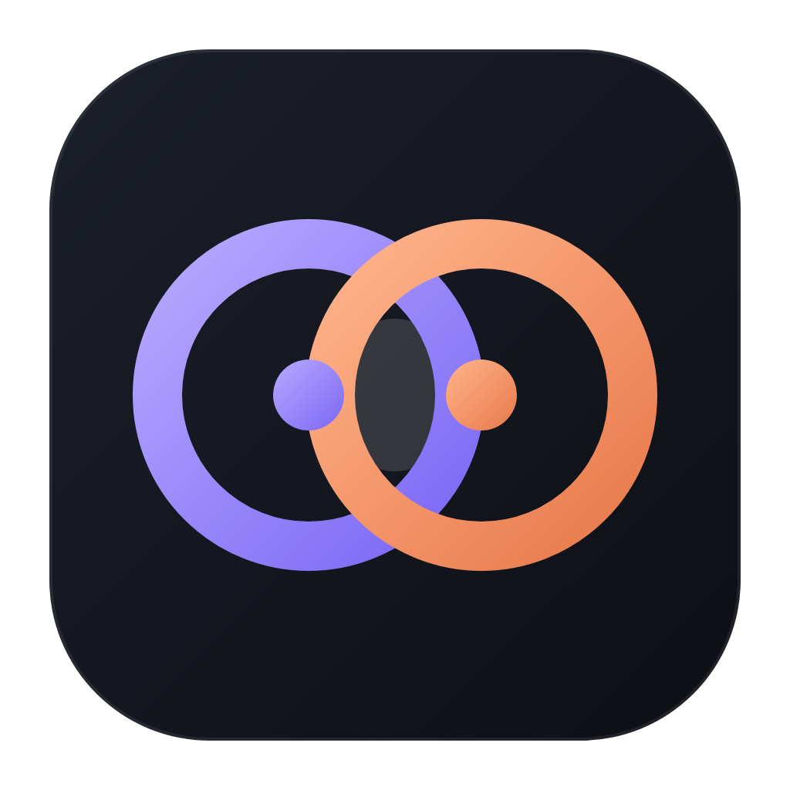

<p align="center"></p>
<h1 align="center">Agent Duo</h1>
<p align="center">Zwei KI-Agenten, eine Oberfläche: <b>Codex</b> plant und prüft, <b>Claude Code</b> programmiert.</p>

Agent Duo ist eine Desktop-App für macOS und Windows. Du beschreibst eine Aufgabe, die App lässt die beiden
offiziellen Kommandozeilen-Programme zusammenarbeiten und zeigt dir jeden Schritt:

**Aufgabe → Plan (Codex) → Umsetzung (Claude Code) → Tests → Review (Codex) → ggf. Korrektur → Ergebnis → Veröffentlichen**

*English: a desktop app that coordinates the official Codex CLI (planning, review, read-only) and Claude Code
(implementation) using your existing subscriptions. The interface is in German.*

## Das brauchst du

Agent Duo bringt **keine Zugänge mit**. Jede Person richtet ihre eigenen ein:

- ein ChatGPT-Abo mit Codex und die [Codex CLI](https://learn.chatgpt.com/docs/codex/cli)
- ein Claude-Abo mit [Claude Code](https://code.claude.com/docs/en/setup)
- [Git](https://git-scm.com/)

Die App findet die Programme selbst, zeigt Version und Anmeldestatus und hilft unter **Einrichtung** beim Installieren und Anmelden.

## Installieren

Lade die passende Datei unter [Releases](../../releases) herunter:

| System | Datei |
| --- | --- |
| macOS (Apple Silicon) | `Agent-Duo-…-mac-arm64.dmg` |
| Windows (64 Bit) | `Agent-Duo-…-win-x64.exe` |

Die Builds sind **nicht signiert**. macOS: beim ersten Start Rechtsklick auf die App → „Öffnen“.
Windows: bei der SmartScreen-Meldung „Weitere Informationen“ → „Trotzdem ausführen“.
Der Windows-Installer ist bisher **nicht auf Windows getestet** – Rückmeldungen sind willkommen.

## Was die App kann

- **Karte:** der ganze Ablauf als Baum – wer gerade was macht
- **Profile:** je Projekt Notizen („wo bin ich stehen geblieben?“), feste Vorgaben und ein automatisches Journal
- **Modellauswahl** und Denkaufwand für beide Agenten
- **Sparmodus** und Anzeige des Verbrauchs
- **Veröffentlichen in drei Klicks:** sichern → ins Projekt übernehmen → auf GitHub hochladen
- **Deploy-Pipeline** (GitHub Actions) von den Agenten bauen lassen

## Sicherheit und Datenschutz

- Alles läuft lokal. Die App liest keine Token-Dateien und speichert keine Passwörter.
- Codex hat technisch erzwungenen Lesezugriff; nur Claude Code ändert Dateien, in einer getrennten Kopie (Git-Worktree).
- Es wird nie automatisch committet, gepusht oder gemergt. Keine Bypass-Flags, kein stiller Wechsel auf API-Abrechnung.

Mehr dazu in der [Anleitung](ANLEITUNG.md).

## Selbst bauen

```bash
npm install
npm start          # App starten
npm test           # Tests
npm run dist:mac   # .dmg bauen (auf macOS)
npm run dist:win   # .exe bauen (auf Windows)
```

Benötigt Node.js 22. Ein Tag `v*` löst den Release-Build auf GitHub Actions aus.

## Lizenz

[MIT](LICENSE). Kein offizielles Produkt von OpenAI oder Anthropic.
